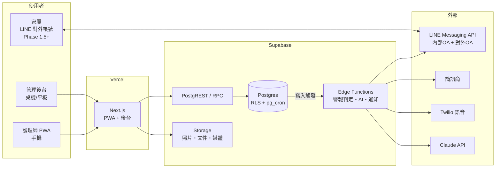

# 05 技術架構與資料模型

本文件定義平台的技術選型、系統架構、LINE 與 AI 整合方式、離線設計、資料模型與角色權限。

---

## 1. 技術選型

| 層 | 決策 | 理由 |
|---|---|---|
| 前端 | **Next.js（App Router）＋ TypeScript ＋ Tailwind ＋ shadcn/ui**；單一專案以路由分組同時出「護理師 PWA」與「管理後台」 | 1–2 人團隊減少 repo 數；生態最大、AI 輔助開發資料最多；未來對外官網可共用 |
| PWA／離線 | Serwist（service worker）＋ Dexie（IndexedDB 離線佇列）＋ TanStack Query | 床邊斷線是常態，離線優先是硬需求 |
| 後端 | **Supabase**（Postgres＋Auth＋RLS＋Realtime＋Storage＋Edge Functions） | 1–2 人開發速度最快；RLS 天然支撐權限與多租戶；底層是純 Postgres，未來可自建遷出，無不可逆鎖定（ADR-001） |
| 多租戶 | **所有資料表自第一天帶 `org_id`＋RLS 隔離** | 第三階段開放平台時不用重構——現在花一天、未來省三個月（ADR-004） |
| 警報升級計時 | pg_cron 每分鐘掃描待升級警報＋Edge Function 發送 | 簡單可靠，不引入額外基礎設施 |
| 簡訊／語音 | 台灣簡訊商（三竹／every8d）＋ Twilio 語音輪撥 | 台灣簡訊到達率與成本 |
| 部署 | Vercel（前端）＋ Supabase Cloud 東京區 | 個資法無資料在地化強制，但跨境傳輸須於隱私政策揭露；成長後評估自建 GCP 台灣機房 |

## 2. 系統架構



**警報資料流**：數值寫入 → DB trigger／RPC 呼叫判定函式（A／B／C 三層，見 02）→ 產生 alert → Edge Function 發 LINE／App 推播 → pg_cron 每分鐘掃描未認領警報 → 依升級鏈補發簡訊／語音，每次嘗試寫入 `alert_notifications`。

## 3. LINE 整合

- **兩個官方帳號分流**（絕不混用）：
  - **對內 OA**：護理師／管理者——派單卡片、紅色警報、SOS、值班通知
  - **對外 OA**：家屬——日報（Phase 1.5）、衛教（Phase 2）、客服
- LINE Login／LIFF 綁定 LINE userId ↔ 平台帳號；綁定流程在首次登入引導完成
- 警報與派單用 **Flex Message 卡片＋按鈕**：一鍵認領／接單，點擊走 LIFF 回平台寫入
- **成本**：Messaging API 免費額度僅 200 則/月，內部帳號必須採購訊息方案，列入營運成本表（見 00 總覽）
- 升級鏈：LINE 為第一通道、簡訊 fallback、語音電話最終手段——LINE 政策或費率變動不影響安全底線

## 4. AI 整合

- 交班總結：Edge Function 呼叫 **Claude API（Haiku 級）**，防幻覺與人工把關見〈03〉
- **去識別化**：送 API 前病人以代號替換（姓名／身分證號／地址／電話不出平台）；「API 資料不用於模型訓練」之條款寫入隱私政策與同意書
- Phase 2 衛教模組整合見〈08〉——衛教服務獨立部署，平台以 API 呼叫＋媒體資產 ID 解析

## 5. 離線設計

- 寫入路徑：UI → Dexie 佇列（本機）→ 連線時批次同步 → 伺服器端判定警報
- 每筆紀錄雙時間戳：`measured_at`（量測時間，可回填）與 `recorded_at`（寫入時間，伺服器）
- 衝突原則：append-only 天然免衝突；同一排程時段重複輸入以 UI 提示合併，不自動覆蓋
- 補登（`recorded_at` − `measured_at` > 30 分鐘）不觸發即時警報（見 02）
- 手機端敏感資料不落地：離線佇列同步成功後即清除；快取個案資料僅保留被指派且服務中個案的最小集

## 6. 資料模型

### 6.1 Entity 總覽

```
org（機構/租戶）
 ├─ users（帳號/角色）─ nurse_profiles（執照、技術標籤、僱傭型態）
 ├─ clients（病人）─ family_contacts
 ├─ cases（個案）─ service_orders（服務單）─ shifts（班次）─ assignments（指派）
 ├─ care_plans（照護計畫：量測排程/翻身頻率/管灌排程）
 ├─ med_orders（藥單）─ med_administrations（給藥紀錄）
 ├─ observations（通用量測寬表）
 ├─ care_events（翻身/抽痰/嘔吐/跌倒/管路事件…）
 ├─ tubes（管路登錄）─ tube_checks；wounds ─ wound_assessments（含照片）
 ├─ alert_rules（預設＋個案覆寫，版本化）─ alerts（生命週期）─ alert_notifications（每次通知嘗試）
 ├─ handoffs（ISBAR＋AI 摘要＋簽收）
 ├─ attendance（打卡）；service_locations（地理圍欄）；oncall_roster（值班表）
 ├─ sos_incidents；incident_reports
 ├─ documents（模板）─ signatures（雜湊存證，Phase 2）
 ├─ edu_assets（媒體資產庫）─ edu_assignments（Phase 2）
 └─ audit_logs / access_logs / notifications
```

### 6.2 關鍵設計決策

**observations 單一寬表**：所有數值量測（生命徵象、血糖、I/O、氧療）進同一張表——

```sql
observations(
  id, org_id, case_id, shift_id, nurse_id,
  type,              -- 'bp' | 'spo2' | 'intake_oral' | 'output_urine' | ...
  category,          -- 'vital' | 'io_in' | 'io_out' | 'o2'
  value jsonb,       -- 彈性欄位（sbp/dbp/部位/性狀…）
  numeric_main numeric GENERATED,  -- 熱欄位：主數值抽出供索引與趨勢查詢
  measured_at, recorded_at, source, device_id,
  superseded_by      -- append-only 更正鏈
)
-- 索引：(case_id, type, measured_at)
```

理由：趨勢查詢、C 層基準線計算、AI 彙整全部走同一條路；新增量測類型不動 schema。行為事件（翻身、抽痰動作本身、跌倒）另立 `care_events`——「數值」與「事件」查詢模式不同。

**alert_rules 版本化**：規則修改產生新版本列，`alerts.rule_version_id` 記錄觸發當下版本——責任釐清關鍵。

**append-only**：`observations`、`care_events`、`handoffs`（歸檔後）、`audit_logs`、`access_logs`、`alert_notifications` 禁止 UPDATE/DELETE（以 RLS＋trigger 強制），更正走 `superseded_by` 新版本鏈。

## 7. 角色與權限矩陣

| 功能 | 管理者 Owner | 護理長/督導 | 護理師 | 家屬（後期） |
|---|---|---|---|---|
| 機構設定/帳號/警報預設規則 | 全部 | 讀 | — | — |
| 個案建檔/警報個案覆寫 | 全部 | 全部 | 讀（被指派者） | — |
| 派單/班表/打卡異常審核 | 全部 | 全部 | 自己的班/接拒單 | — |
| 照護紀錄 | 讀 | 讀＋覆核 | 被指派個案讀寫（僅服務期間） | 摘要唯讀 |
| 警報認領/處置/結案 | 可 | 主責 | 現場處置回報 | 不可見內部處置 |
| 交班 | 讀 | 讀＋抽核 | 交/接班簽收 | 不可見 |
| SOS | 接收 | 接收/結案 | 觸發 | — |
| 報表匯出 | 可 | 部分 | 自己工時 | — |

- RLS 實作「**指派關係決定可見範圍**」：護理師只能存取被指派個案、且僅服務期間；個案結案 30 天後對其轉不可見
- **家屬看「溝通版日報」**（VS 圖表、進食、睡眠、照片、溫和摘要），與內部交班備註、警報處置細節**完全分離**——內部紀錄要誠實直白，對外溝通要專業溫和；混用會讓護理師不敢寫真話
- 調度員角色 MVP 併入督導；權限旗標先留

## 8. 開發驗收要點

- [ ] 每張表帶 `org_id`；跨 org 讀寫被 RLS 拒絕（自動化測試）
- [ ] 護理師存取非指派個案／服務期間外被拒絕
- [ ] append-only 表的 UPDATE/DELETE 被拒絕
- [ ] 離線輸入 → 斷網 → 恢復同步全流程實測；雙時間戳正確
- [ ] pg_cron 升級掃描與 Edge Function 通知鏈整合測試
- [ ] LINE 內外 OA 分流；Flex 卡片按鈕回寫平台成功
- [ ] AI 呼叫前去識別化以測試資料驗證（真名不得出現在 API payload）
